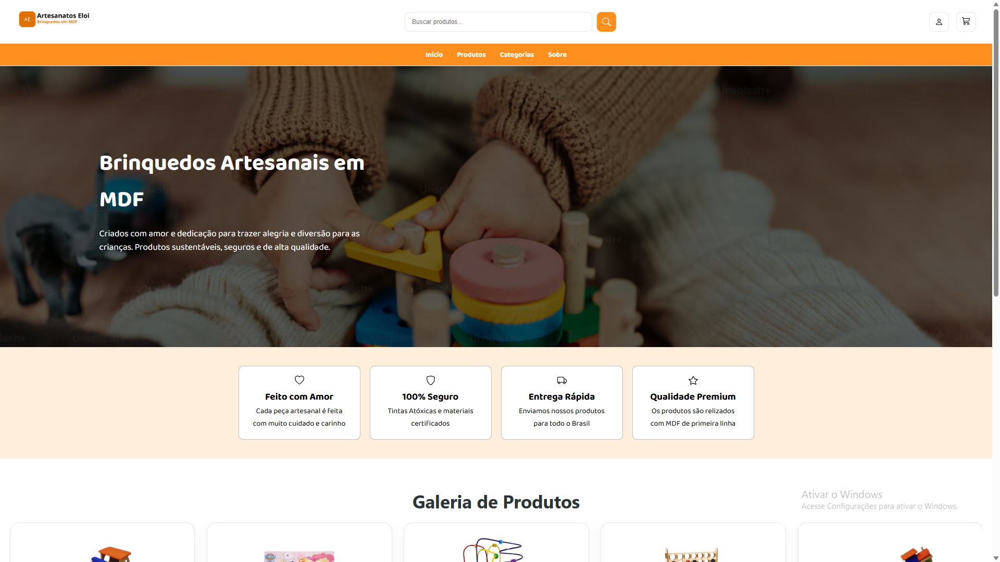
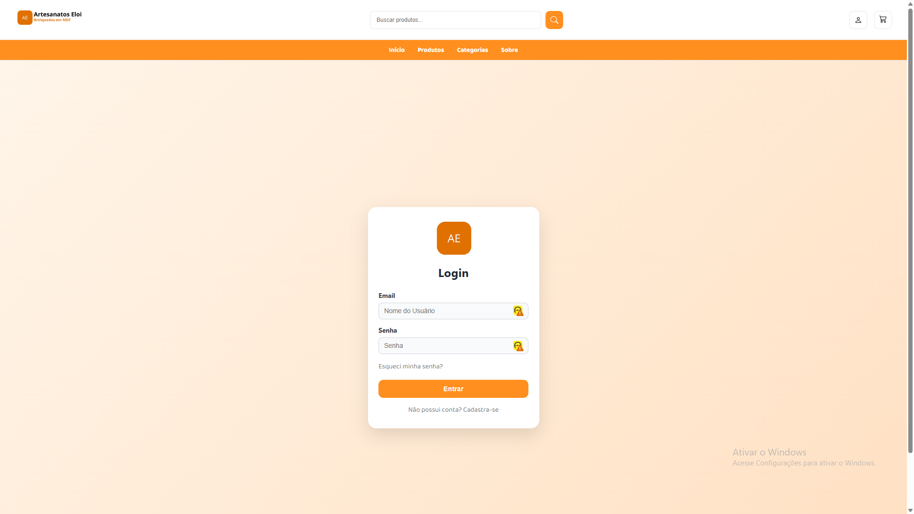
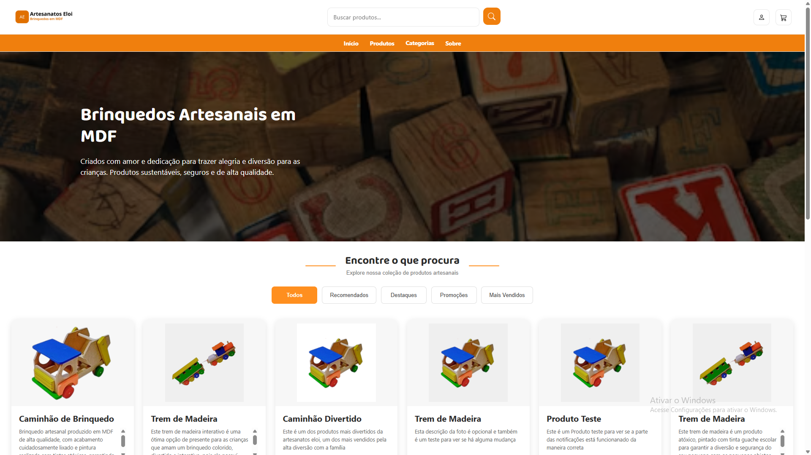
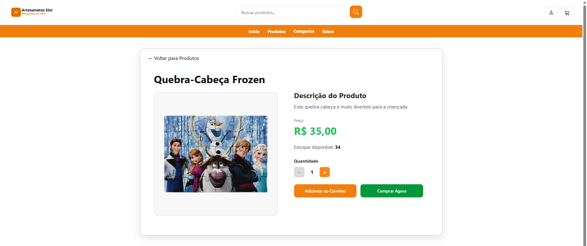
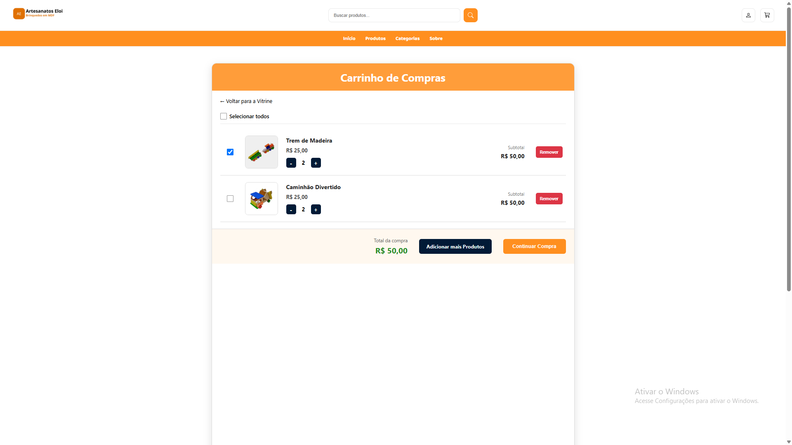
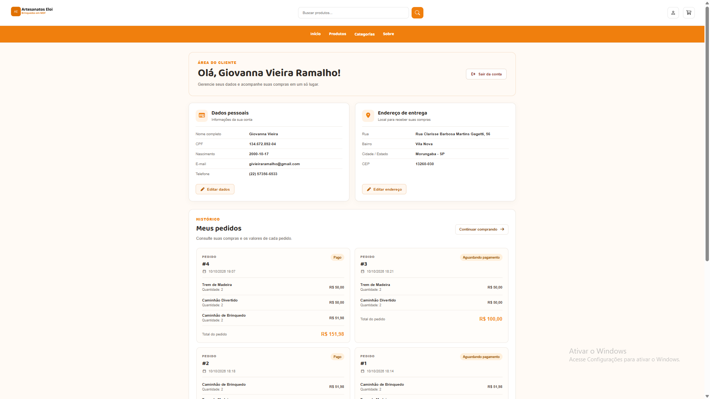

# 🧸 Artesanatos Eloi

<p align="center">
  
</p>

<p align="center">
  <strong>Brinquedos artesanais feitos com criatividade, carinho e dedicação.</strong>
</p>

<p align="center">
  Um sistema de comércio eletrônico desenvolvido para apresentar produtos artesanais, facilitar as compras e gerenciar as operações da loja.
</p>

---

## 📌 Sobre o projeto

O **Artesanatos Eloi** é um sistema web de comércio eletrônico desenvolvido para uma loja de brinquedos artesanais. O projeto busca proporcionar uma experiência de navegação simples e organizada para os clientes, além de oferecer funcionalidades administrativas para o gerenciamento da loja.

A aplicação permite visualizar produtos, criar uma conta, acessar funcionalidades exclusivas para usuários autenticados e realizar o fluxo de compras.

## 🎯 Objetivos

* Apresentar os produtos artesanais de forma organizada.
* Facilitar a navegação e a experiência de compra.
* Permitir o cadastro e a autenticação de usuários.
* Disponibilizar um carrinho de compras.
* Facilitar o gerenciamento de produtos e outras operações administrativas.
* Integrar o processo de pagamento eletrônico.

## ✨ Funcionalidades

### 🛍️ Para os clientes

* Visualização do catálogo de produtos.
* Filtragem de produtos por categorias.
* Visualização de detalhes dos produtos.
* Cadastro e login de usuários.
* Gerenciamento do carrinho de compras.
* Seleção de produtos para finalizar a compra.
* Cadastro e consulta de informações pessoais e endereço.
* Recuperação de senha por e-mail.
* Processo de finalização de compra com integração ao Stripe.

### ⚙️ Para a administração e os funcionários

* Cadastro e edição de produtos.
* Gerenciamento de estoque e disponibilidade dos produtos.
* Gerenciamento de categorias.
* Gerenciamento de formas de pagamento.
* Consulta e análise de vendas.
* Área administrativa com funcionalidades específicas para cada perfil.

> Observação: as funcionalidades disponíveis podem variar conforme o perfil de acesso e a implementação atual do sistema.

## 🖥️ Demonstração do sistema

As imagens abaixo podem ser utilizadas para apresentar visualmente as principais páginas do projeto.

### Página inicial



### Sobre - Artesanatos Eloi


### Página do Login



### Catálogo de produtos



### Ver Produto



### Carrinho de compras



### Área do usuário



## 🛠️ Tecnologias utilizadas

| Tecnologia   | Utilização                          |
| ------------ | ----------------------------------- |
| PHP          | Processamento do lado do servidor   |
| MySql        | Banco de dados relacional           |
| HTML5        | Estrutura das páginas               |
| CSS3         | Estilização e responsividade        |
| JavaScript   | Interatividade das páginas          |
| Bootstrap 5  | Componentes e recursos de interface |
| Font Awesome | Ícones                              |
| Stripe       | Integração de pagamento eletrônico  |
| PHPMailer    | API para envio de emails            |
| XAMPP        | Ambiente de desenvolvimento local   |

## 🗄️ Banco de dados

O sistema utiliza o MariaDB para armazenar informações relacionadas aos usuários, produtos e operações da loja.

Entre as informações gerenciadas estão:

* Dados dos usuários.
* Informações dos funcionários.
* Produtos, preços e descrições.
* Estoque e disponibilidade dos produtos.
* Informações pessoais e endereços.
* Dados relacionados às compras e aos pagamentos.

A conexão com o banco de dados é configurada no arquivo `banco/config.php`.

## 🚀 Como executar o projeto

### Pré-requisitos

Antes de executar a aplicação, é necessário ter:

* [XAMPP](https://www.apachefriends.org/) instalado.
* PHP disponível no ambiente XAMPP.
* MySQL Workbench (https://www.mysql.com/products/workbench/) em execução.
* VSCode para modificação do código, caso necessário
* Um navegador atualizado.

### 1. Baixe ou clone o projeto

Coloque a pasta do projeto no diretório `htdocs` do XAMPP.

O caminho esperado é:

```text
C:\xampp\htdocs\artesanatos-eloi
```

### 2. Inicie o XAMPP

Abra o painel de controle do XAMPP e inicie os serviços necessários:

* Apache.
* MySQL/MariaDB.

### 3. Configure o banco de dados

Crie o banco de dados utilizado pelo projeto e importe o script SQL de criação das tabelas.

Em seguida, confira as configurações de conexão no arquivo:

```text
banco/config.php
```

Ajuste o endereço do servidor, a porta, o nome do banco de dados, o usuário e a senha de acordo com o seu ambiente.

### 4. Configure os serviços externos

Se for utilizar a recuperação de senha por e-mail ou o pagamento pelo Stripe, configure as respectivas credenciais de acordo com os arquivos utilizados pelo projeto.

**Link do repositório do Stripe** - (https://github.com/stripe/stripe-php)
Siga o passo a passo da instalação do Stripe

**Importante:** utilize chaves de teste do Stripe durante o desenvolvimento e nunca publique senhas, chaves secretas ou credenciais de e-mail no repositório.

### 4.1. Configuração das chaves de API
Para que o projeto funcione da maneira adequada, é necessário colocar as suas chaves de API tanto do PHPMailer, quanto do Stripe.
Segue abaixo recomendações de vídeo de como configurar as suas chaves de API corretamente

**Chave de API - PHPMailer** - (https://youtu.be/Lz6fJChKRtA?si=BzB8N3WMzQ--rLd8) 

**Chave de API - Stripe** - (https://youtu.be/7Z3Jz9VY0VU?si=N3wkObmM992P7S3y)

### 4.2. Aplicação das Chaves API
Após criar corretamente as chaves API conforme os vídeos, elas devem ser colocadas corretamente nos determinados destinos

**Chave de API - PHPMailer** - banco/mailer.php

**Chave de API - Stripe** - finalizar-pagamento/checkout.php

Após colocar as chaves API, faça um teste para ver se está funcionando corretamente.

### 5. Acesse a aplicação

Com o Apache e o banco de dados em execução, abra o navegador e acesse:

```text
http://localhost/artesanatos-eloi/
```

## 📁 Organização do projeto

A estrutura geral inclui as seguintes áreas:

```text
artesanatos-eloi/
├── admin/                  # Área administrativa
├── banco/                  # Conexão e operações com o banco
├── cadastrar-produtos/     # Cadastro de produtos
├── categorias/             # Gerenciamento de categorias
├── carrinho/               # Funcionalidades do carrinho
├── finalizar-pagamento/    # Processo de pagamento
├── funcionarios/           # Área dos funcionários
├── img/                    # Imagens e recursos visuais
├── login/                  # Autenticação de usuários
├── pagina-inicial/         # Página inicial
├── pagina-usuario/         # Área do usuário
├── produtos/               # Catálogo e detalhes dos produtos
├── stripe/                 # Biblioteca de integração com Stripe
└── README.md               # Documentação do projeto
```

## 🔐 Segurança

O projeto utiliza recursos do PHP para o gerenciamento de sessões e a comunicação com o banco de dados por meio de PDO.

Para manter a segurança durante o desenvolvimento e a publicação:

* Não compartilhe senhas ou credenciais privadas.
* Utilize consultas preparadas para operações no banco de dados.
* Armazene senhas de usuários com mecanismos seguros de hash.
* Proteja as chaves secretas dos serviços externos.
* Valide os dados recebidos dos formulários.
* Utilize HTTPS quando o sistema estiver publicado.

## 📌 Status do projeto

Projeto em desenvolvimento, com funcionalidades implementadas e aprimoramentos realizados conforme a evolução do sistema.

## 👩‍💻 Desenvolvimento

**Artesanatos Eloi** — sistema web de comércio eletrônico para produtos artesanais.

Desenvolvido com foco na organização, na usabilidade e no gerenciamento das operações de uma loja virtual.

Este sistema foi desenvolvido por **Giovanna Vieira Ramalho** para o Trabalho de Conclusão de Curso (TCC) do curso de Desenvolvimento de Sistemas - Período da Tarde da Etec João Belarmino

---

<p align="center">
  Feito com dedicação para o Artesanatos Eloi 🧡
</p>
